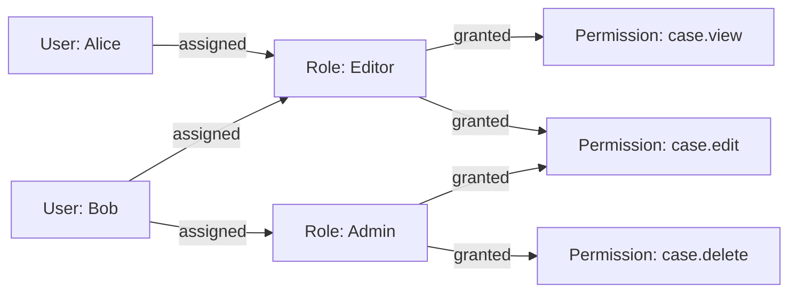

# 2. Authorization

Authorization answers: **now that we know who you are, what are you allowed to do?** This is a
separate system from authentication, and treating them as one thing is how you end up with bugs
like "any logged-in user can view any other user's invoice by changing the ID in the URL" — that's
not an authentication failure (the user really is who they say they are), it's a **missing
authorization check** (an IDOR — Insecure Direct Object Reference, see [05](05-secure-coding-owasp.md)).

## 2.1 The core rule: check authorization on every request, server-side

Never trust a client to only *show* the "delete" button to admins and call it a day — that's UI
convenience, not security. The server must re-check, on every single request, whether the
authenticated principal is allowed to perform that specific action on that specific resource.
"We hid the button" is not a control.

## 2.2 RBAC — Role-Based Access Control

Users are assigned **roles** (Admin, Editor, Viewer); roles are assigned **permissions**
(`case.edit`, `case.delete`); a request is authorized if the user's roles collectively include the
required permission.



**Recommendation:** use RBAC as the default baseline for any new system — it's the simplest to
reason about, audit, and explain to a non-technical stakeholder ("who has the Admin role" is a
one-query answer). Reach for ABAC/a policy engine ([§2.3](#23-abac--pbac--attributepolicy-based-access-control))
only when you have a genuine cross-cutting rule RBAC can't express cleanly (time-of-day
restrictions, resource-attribute matching at scale) — introducing a policy language for its own
sake adds real complexity cost for a system that may never need that expressiveness.

This is the model we found in the reference codebase's Security module: `SEC.User → UserRole → Role →
RolePermission → Permission`, resolved fresh at session-lookup time — see
[11 - Applied](11-applied-to-this-codebase.md) for the exact tables and code.

**RBAC's weakness:** it's coarse-grained. "Can edit cases" doesn't express "can edit cases **in
their own mission**" or "can edit cases **they created**." Real systems end up bolting
resource-scoped checks on top of RBAC in the business logic layer (e.g., "user has
`Case.Edit` permission AND `case.missionCode == user.missionCode`") — this hybrid is extremely
common and is not a design flaw, it's RBAC being used for the coarse gate and a domain-specific
check for the fine-grained one.

## 2.3 ABAC / PBAC — Attribute/Policy-Based Access Control

Instead of static role-permission mappings, a **policy engine** evaluates a rule against
attributes of the user, the resource, and the environment at request time:

```
allow if:
  user.department == resource.department
  AND user.clearanceLevel >= resource.classification
  AND time.hour BETWEEN 9 AND 17
```

Tools: Open Policy Agent (OPA)/Rego, AWS IAM policies (a real, widely-deployed ABAC/PBAC system),
Casbin. More expressive than RBAC, but harder to reason about and audit — a policy language is
effectively a small programming language, and small programming languages accumulate bugs like any
other.

## 2.4 The confused deputy problem

A classic vulnerability class: a program with legitimate elevated privileges is tricked by a
less-privileged caller into misusing that privilege on the caller's behalf. Named for a compiler
service that had disk-write access and was tricked into overwriting a system file via a
maliciously-named "billing file" argument.

**Modern example — SSRF as a confused deputy:** your server has network access to your internal
cloud metadata endpoint (`169.254.169.254`) that an external attacker doesn't. If your app fetches
a URL supplied by the user (e.g. "import an image from this URL"), and doesn't validate it, an
attacker points it at the metadata endpoint and your own server — the deputy with more privilege
than the attacker — fetches the cloud credentials *for* them. See [05](05-secure-coding-owasp.md)
§SSRF.

## 2.5 Least privilege, and why "just in case" permissions are a liability

Every permission a principal (a user, a service account, a CI pipeline) holds is something an
attacker gains for free the moment that principal is compromised. Grant the minimum permission set
that lets the job get done, nothing more:
- A service that only reads from a queue should not have write/delete IAM permissions on it.
- A CI pipeline that runs tests should not hold production deploy credentials unless it's the
  deploy stage.
- An `[Authorize]` policy that only needs `Case.View` should never accept `Case.Modify` as
  sufficient just because it's convenient to reuse — always give the minimum access needed to authorize the specific action, not "any elevated role."

## 2.6 Default-deny, not default-allow

Every route, every field, every action should require an explicit grant to be reachable. A system
where "anything without an explicit rule is allowed" silently accumulates unauthorized access
every time someone forgets to add a check on a new endpoint — and someone always eventually
forgets. This is exactly the kind of gap a dedicated architecture test (checking every controller
action carries an explicit `[Authorize]` or `[AllowAnonymous]`) is designed to catch — see
[11](11-applied-to-this-codebase.md) for a real example of this rule being only partially enforced
in a production codebase.

## Further reading

- [Open Policy Agent (OPA) / Rego policy language](https://www.openpolicyagent.org/docs/latest/policy-language/)
- [AWS IAM policy documentation — a real, widely-deployed ABAC/PBAC system](https://docs.aws.amazon.com/IAM/latest/UserGuide/introduction.html)
- [Casbin — open-source access control library supporting RBAC/ABAC](https://casbin.org/)
- [The Confused Deputy Problem — Norm Hardy's original 1988 paper](http://www.cap-lore.com/CapTheory/ConfusedDeputy.html)
- [OWASP Access Control Cheat Sheet](https://cheatsheetseries.owasp.org/cheatsheets/Access_Control_Cheat_Sheet.html)

---
**Next:** [3. TLS/SSL In Depth →](03-transport-security-tls.md)
