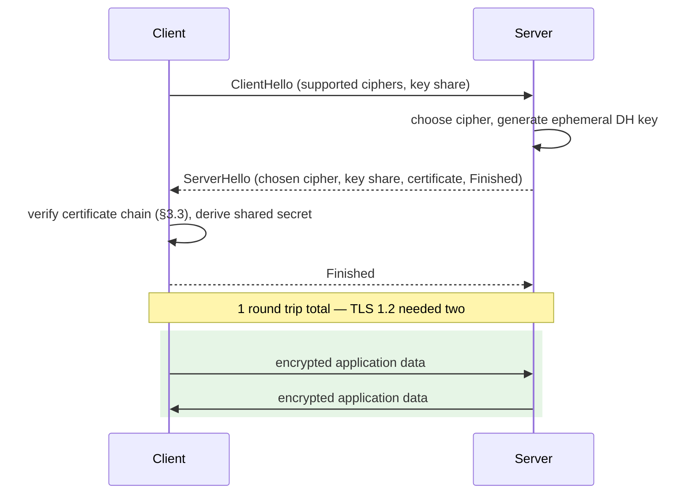
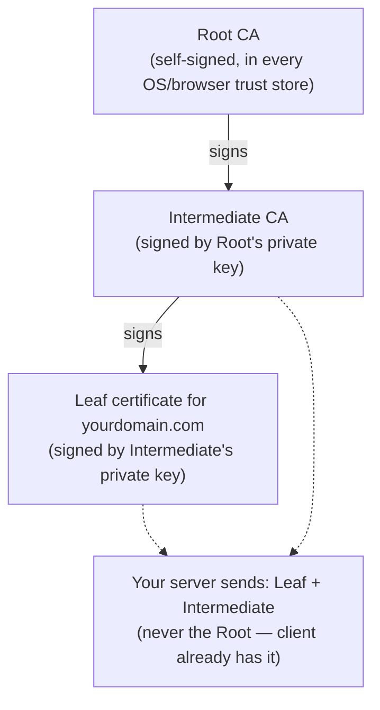

# 3. TLS/SSL In Depth

"SSL" and "TLS" get used interchangeably in casual speech, but they're not the same thing, and the
distinction matters: **SSL (versions 1.0–3.0) is broken and has been formally deprecated since
2015 (RFC 7568). TLS is its successor.** If anyone in your organization says "we're securing this
with SSL," they either mean TLS loosely, or you have a real problem. There is no legitimate reason
to enable SSL 3.0 or TLS 1.0/1.1 on anything built today — TLS 1.2 is the practical minimum, TLS
1.3 is the current standard and should be preferred.

## 3.1 What TLS actually provides — three separate guarantees

People say "TLS encrypts the connection" as if that's the whole story. It provides three distinct
properties, and it's worth knowing which one stops which attack:

1. **Confidentiality** — the payload is encrypted in transit, so a network eavesdropper (a
   coffee-shop Wi-Fi sniffer, a malicious ISP, a nation-state tap) can't read it.
2. **Integrity** — an authenticated encryption mode (AEAD, like AES-GCM or ChaCha20-Poly1305) means
   any tampering with the ciphertext in transit is detected and the connection is aborted. Without
   this, an attacker could flip bits in the ciphertext and have it silently decrypt to garbage or,
   in older non-AEAD modes, to attacker-influenced plaintext.
3. **Authentication** — the certificate proves *who you're actually talking to* (that
   `bank.com`'s private key holder is the one you're connected to), not just that the channel is
   private. **This is the one people forget.** A connection can be perfectly encrypted and still be
   a man-in-the-middle attack if the certificate isn't actually validated — you've just built a
   very secure, very private channel directly to the attacker.

## Recommendation

**Use TLS 1.3 only where all your clients support it; TLS 1.2 as the floor everywhere else. Never
enable SSL 3.0 or TLS 1.0/1.1 — there is no legitimate reason to in anything built today.** Prefer
AEAD cipher suites exclusively (`TLS_AES_128_GCM_SHA256`, `TLS_CHACHA20_POLY1305_SHA256` under 1.3
— these are the *only* suites 1.3 offers, which is exactly why it's the safer default). If you
must support 1.2 for legacy clients, explicitly disable CBC-mode and RC4 suites rather than
accepting the platform default, which often still lists them for compatibility. Automate
certificate issuance/renewal (ACME) so "the cert expired" is structurally impossible rather than a
recurring on-call incident.

## 3.2 The TLS 1.3 handshake (why it's faster and safer than 1.2)



TLS 1.3 collapsed this to a **single round trip** (1-RTT) before application data flows — TLS 1.2
took two round trips. It also **removed** an entire category of historically-exploited weak
options: RC4, static RSA key exchange (no forward secrecy), CBC-mode ciphers vulnerable to padding
oracle attacks (BEAST, POODLE, Lucky13), and compression (CRIME/BREACH). TLS 1.3 gives you no
footgun to misconfigure into a weak cipher — the whole negotiable cipher list is modern AEAD
ciphers only. This is the single strongest practical argument for upgrading: it's not just faster,
it structurally removes bugs that used to require careful manual configuration to avoid.

**Forward secrecy**, mandatory in TLS 1.3: each session uses an ephemeral Diffie-Hellman key
exchange, so even if the server's long-term private key is later stolen, past recorded traffic
cannot be decrypted retroactively. Without forward secrecy (old static RSA key exchange), an
attacker who records encrypted traffic today and steals your private key years from now can
decrypt everything they recorded. This is exactly the threat model "record now, decrypt later"
surveillance is built on.

## 3.3 The certificate chain and how validation actually works



When a client connects, the server sends the leaf cert plus intermediates (**not** the root — the
client already has that in its trust store). The client walks the chain: verify the leaf's
signature was made by the intermediate's key, verify the intermediate's signature was made by a
root the client already trusts, check every certificate's expiry, check the leaf's Subject
Alternative Name (SAN) matches the hostname being connected to, and check revocation status (OCSP,
increasingly OCSP stapling where the server proactively presents a signed "not revoked" proof so
the client doesn't have to make a separate, latency-adding, privacy-leaking call to the CA).

**Common real-world failures, roughly in order of how often they actually happen:**
- **Expired certificate** — the most common outage cause in production, entirely preventable with
  automated renewal (ACME/Let's Encrypt, cert-manager on Kubernetes) and expiry monitoring alerts.
- **Hostname mismatch** — cert issued for `api.example.com`, service accessed via
  `example-api.internal` — validation correctly fails; the fix is issuing for the right name or a
  proper SAN list, never "disable hostname verification."
- **Missing intermediate certificate** — browsers often cache intermediates from other sites and
  paper over this, but non-browser clients (curl, most language HTTP libraries, mobile apps) often
  don't, so "works in my browser, fails from the server" is the classic symptom. Always serve the
  full chain.
- **Self-signed or untrusted CA in production** — fine for local dev, a genuine incident in
  production; it trains users and client code to click through/ignore trust warnings, which is
  exactly the muscle memory a real MITM attack relies on.

## 3.4 The one line of code that breaks all of this

```csharp
// NEVER DO THIS OUTSIDE A LOCAL DEV WORKAROUND, AND EVEN THEN, PREFER A REAL CERT
ServicePointManager.ServerCertificateValidationCallback = (s, cert, chain, errors) => true;
```
```python
# NEVER DO THIS
requests.get(url, verify=False)
```
```javascript
// NEVER DO THIS
process.env.NODE_TLS_REJECT_UNAUTHORIZED = '0';
```

Every one of these disables certificate validation entirely — you keep the encryption, you lose
the authentication guarantee (§3.1), which means you've built a perfectly private tunnel straight
to a man-in-the-middle attacker who presents any certificate at all, self-signed or otherwise. This
single line is one of the most common "looked fine in testing, was a live incident in production"
bugs, usually introduced to silence a local-dev cert error and then accidentally shipped. If you
need to trust a private/internal CA, add that CA to the trust store properly — don't disable
validation.

## 3.5 Mutual TLS (mTLS) between services

Covered in [01 §1.8](01-authentication.md#18-mutual-tls-mtls) as an authentication mechanism — the
transport-layer view is: the server's `TLSListener` is configured to *request* (optionally
require) a client certificate during the handshake, verify it against a trusted CA, and the
resulting authenticated client identity is available to application code before a single byte of
HTTP is processed. This is the backbone of zero-trust service meshes (Istio, Linkerd auto-mTLS
between pods) — every internal call is authenticated at the transport layer regardless of network
location, so "it's on the internal network" stops being a security boundary at all.

## 3.6 HSTS (HTTP Strict Transport Security)

A response header — `Strict-Transport-Security: max-age=31536000; includeSubDomains; preload` —
that tells the browser "never connect to this domain over plain HTTP again, even if the user types
`http://` or clicks an `http://` link, for the next year." This closes a real gap: without it, the
very first request a user ever makes to your site (before they've been redirected to HTTPS once)
is vulnerable to **SSL stripping** — an on-path attacker intercepts the initial plaintext HTTP
request and simply never redirects the victim to HTTPS, silently proxying everything and
eavesdropping. The `preload` directive lets you submit your domain to a hardcoded list shipped
inside browsers themselves, closing the gap for even the very first visit ever.

## 3.7 Certificate pinning — and why it's mostly deprecated for public apps

Pinning hardcodes which specific certificate or public key a client will accept for a domain,
rejecting anything else even if it chains to a valid, trusted CA. This defends against a
compromised or coerced CA issuing a fraudulent certificate for your domain. **Public browsers have
mostly abandoned this (Chrome removed HPKP support)** because a botched pin rollout can
permanently lock users out with no recovery path, and it's now considered a worse operational risk
than the CA-compromise scenario it defends against for public web traffic. It's still legitimately
used in **native mobile apps** talking to a known, single backend, where the operational risk is
more controllable.

## 3.8 Practical checklist for anything you deploy

- TLS 1.2 minimum, prefer 1.3-only where your clients support it.
- Automate certificate renewal; alert on expiry, don't discover it in production.
- Serve the full certificate chain, including intermediates.
- `HSTS` header on every HTTPS response, `includeSubDomains`, consider `preload`.
- Never disable certificate validation in code that ships, for any environment that isn't your own
  local machine — and even then, prefer fixing the underlying trust-store issue.
- Redirect all plain HTTP to HTTPS at the edge (load balancer/reverse proxy), don't rely on
  application code to remember.
- For service-to-service calls inside your own infrastructure: don't assume "internal network"
  means "trusted" — see [08](08-api-and-service-security.md).
