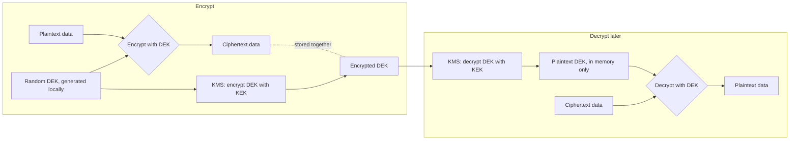

# 4. Secrets & Key Management

A "secret" is anything that, if disclosed, lets an attacker impersonate a system or decrypt data:
API keys, database passwords, TLS private keys, signing keys, encryption keys, OAuth client
secrets. Managing them badly is one of the most common root causes of real breaches — not because
the cryptography was weak, but because the key protecting the cryptography was sitting somewhere
readable.

## 4.1 Why `.env` files and hardcoded secrets are a real risk, not just a lint warning

- **Git history is forever.** Committing a secret and deleting it in the next commit does not
  remove it — it's still in the repo's history, retrievable by anyone with clone access, forever,
  unless you rewrite history (which is disruptive and easy to get wrong) and rotate the secret
  anyway (which you should do regardless — assume a committed secret is burned).
  - Verified in this project: `iNXG-frontend`'s own architecture notes call out that
    `Host/IOM.Host.Api/appsettings.Development.json` is gitignored specifically so the auth
    password (`IOM!26?root**`) documented for local dev never lands in source control — that's the
    right instinct, applied consistently.
- **CI logs, error messages, and crash dumps leak secrets that are in environment variables** if
  the code (or a dependency) ever logs `process.env`/`Environment.GetEnvironmentVariables()` for
  debugging and forgets to redact it. An env var is safer than a hardcoded string, but it is not a
  vault — it's still plaintext, readable by anything with process access.
- **Shared secrets don't scale to revocation.** If one server's config file leaks and every
  environment uses the same DB password, you must rotate everywhere, immediately, under pressure.

## 4.2 Secrets managers / vaults

Dedicated systems (HashiCorp Vault, AWS Secrets Manager, Azure Key Vault, GCP Secret Manager) that:
- Store secrets encrypted at rest, decrypted only in memory when fetched by an authenticated,
  authorized caller (a service identity, not a human).
- Provide **audit logs** of every access — who/what read this secret, and when. This is often the
  single biggest practical improvement over env vars: you find out a secret was accessed instead
  of finding out only after it's been misused.
- Support **dynamic secrets** — e.g. Vault can generate a short-lived, unique DB credential per
  request instead of one static password shared by every service instance, so a leaked credential
  expires in minutes instead of being valid until manually rotated.
- Support automated **rotation** without a deploy — the app fetches the current value at runtime
  instead of it being baked into a config file at build time.

## 4.3 Envelope encryption — how KMS actually protects large amounts of data

You don't encrypt a multi-gigabyte database export directly with a KMS (Key Management Service)
API call — that's slow and often not what KMS is built for. Instead:

1. Generate a random **Data Encryption Key (DEK)** locally.
2. Encrypt the actual data with the DEK (fast, symmetric, local).
3. Ask KMS to encrypt the **DEK itself** with a **Key Encryption Key (KEK)** that never leaves the
   KMS/HSM.
4. Store the encrypted DEK alongside the encrypted data.

To decrypt later: send the tiny encrypted DEK to KMS, get back the plaintext DEK (KMS does this
fast because it's small), then decrypt the actual data locally with it. The KEK — the thing that
actually matters most — never touches your application's memory at all. This is the pattern behind
S3 server-side encryption, most cloud "encrypt this column/file" features, and is worth
understanding because it's *why* KMS-integrated systems can claim "the key never leaves the HSM"
while still handling large volumes of data efficiently.

## 4.4 Key rotation

Every key should have a planned rotation schedule, not just an "if compromised" reactive one:
- Signing keys (JWT, TLS): rotate on a schedule; support **key ID (`kid`) headers** so multiple
  keys can be valid simultaneously during rollover — old tokens signed with the previous key still
  validate until they naturally expire, new tokens use the new key, and you never have a "big bang
  cutover" that breaks every currently-logged-in user at once.
- Database/service credentials: rotate on a schedule via the secrets manager, ideally with zero
  application downtime (the app re-fetches on a timer or on auth failure).
- **Always have a plan for the "we know this leaked" rotation**, tested before you need it — an
  incident is the worst time to discover your rotation process has a manual step nobody remembers.

## 4.5 Secrets in CI/CD pipelines

CI runners are a favorite target because they routinely hold deploy credentials, cloud API keys,
and source access all in one place:
- Never `echo` a secret in a build log — most CI systems mask known secret values automatically,
  but only if the secret is registered as a secret variable, not a plain env var typed into a
  script.
- A malicious pull request from a fork should never be able to run a CI job that has access to
  repository secrets (e.g. deploy keys) before a maintainer reviews it — this is exactly the class
  of attack `pull_request_target` misuse in GitHub Actions has enabled in real supply-chain
  incidents.
- Treat build artifacts as untrusted output that might contain baked-in secrets if a build script
  is careless — scan them before publishing.

## 4.6 The one rule that covers most of this

**A secret that's hard to rotate is a design bug, discovered at the worst possible time.** Build
the rotation path before you need it, not while you're firefighting a leak.

## Further reading

- [HashiCorp Vault documentation](https://developer.hashicorp.com/vault/docs)
- [AWS Secrets Manager](https://aws.amazon.com/secrets-manager/) · [Azure Key Vault](https://azure.microsoft.com/en-us/products/key-vault) · [GCP Secret Manager](https://cloud.google.com/secret-manager)
- [AWS KMS — envelope encryption concepts](https://docs.aws.amazon.com/kms/latest/developerguide/concepts.html#enveloping)
- [OWASP Secrets Management Cheat Sheet](https://cheatsheetseries.owasp.org/cheatsheets/Secrets_Management_Cheat_Sheet.html)
- [GitHub Actions security hardening (secrets in CI/CD, `pull_request_target` risks)](https://docs.github.com/en/actions/security-guides/security-hardening-for-github-actions)

---
**Next:** [5. Secure Coding & the OWASP Top 10 →](05-secure-coding-owasp.md)
