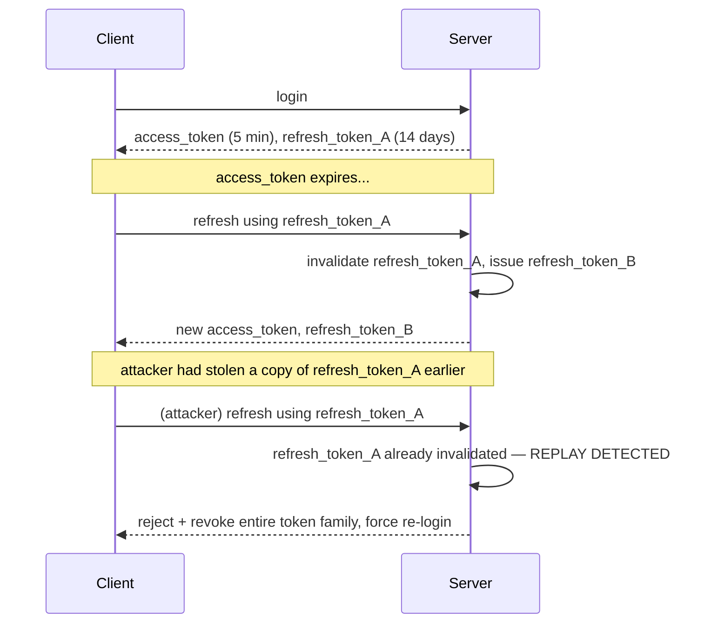

# 6. Session & Token Security

This file is the practical follow-up to [01 §1.2-1.3](01-authentication.md) — once you've chosen
sessions or tokens, here's how they actually get broken in production, and how to not let that
happen.

## 6.1 Session fixation

**The attack:** an attacker gets a victim to authenticate using a session ID the attacker already
knows (e.g. by sending a link with `?sessionid=attacker-chosen-value`, on a server that accepts a
client-supplied session ID before login and just "attaches" the user to it after). Once the victim
logs in, the attacker — who already has that same session ID — is now also logged in as the
victim.

**Fix:** always issue a **brand-new session ID upon successful login**, discarding whatever
pre-login session (if any) existed. Never let a client dictate its own session identifier.

## 6.2 Where to store a token on the client, and why it matters

This is one of the most consequential, most argued-about decisions in frontend security, and the
tradeoff is real, not a matter of taste:

| Storage | Vulnerable to XSS (JS can read it)? | Vulnerable to CSRF (auto-sent cross-site)? |
|---|---|---|
| `localStorage` / `sessionStorage` | **Yes** — any XSS on the page can read and exfiltrate it | No |
| Cookie, `HttpOnly` | No — JavaScript cannot read it | **Yes**, unless `SameSite` set |
| Memory only (JS variable, lost on refresh) | No | No |

**The honest tradeoff:** `localStorage` trades CSRF risk for XSS risk. An `HttpOnly` cookie trades
XSS-token-theft risk for CSRF risk (mitigated by `SameSite`, see
[05 §5.3](05-secure-coding-owasp.md)). Given that XSS is generally considered easier to introduce
accidentally (one unescaped render) and more devastating (full token exfiltration, replayable
anywhere, vs. CSRF which is limited to actions the forged request format allows) — **the current
best-practice consensus is `HttpOnly` + `Secure` + `SameSite=Lax` cookies for the session/refresh
token, with CSRF tokens as defense-in-depth**, not `localStorage`. If you do use `localStorage`
(common in SPA/mobile-first apps for simplicity), your XSS defenses (output encoding, CSP) become
load-bearing for auth security, not just page-integrity hygiene — treat any XSS finding in that
architecture as a full account-takeover-severity bug, not a cosmetic one.

## 6.3 Access tokens vs. refresh tokens

The standard OAuth2/OIDC pattern deliberately splits token lifetime into two tiers:
- **Access token** — short-lived (minutes), sent with every API request, used to authorize calls.
  Short lifetime limits the blast radius if one leaks — it's only useful to an attacker for a few
  minutes.
- **Refresh token** — long-lived (days/weeks), used *only* to obtain a new access token when the
  old one expires, never sent to a resource API directly. Stored more carefully (often `HttpOnly`
  cookie, sometimes bound to a specific device/IP as an extra check) precisely because it's the
  long-lived credential that actually matters if it leaks.

**Refresh token rotation:** each time a refresh token is used, issue a brand-new one and invalidate
the old one. If a previously-invalidated refresh token is ever presented again, that's a strong
signal it was stolen and replayed by an attacker (the legitimate client already rotated past it) —
treat this as a compromise signal and revoke the entire token family, forcing re-login.

**Recommended baseline:** short-lived access token (minutes) + rotating refresh token, both
delivered as `HttpOnly`/`Secure`/`SameSite` cookies where the client is a browser — this combines
the leak-tolerance of short-lived tokens with the family-revocation detection shown above, and
avoids the `localStorage` XSS exposure from [§6.2](#62-where-to-store-a-token-on-the-client-and-why-it-matters)
entirely.

## 6.4 Logout that actually logs out

A common, easy-to-miss bug: "logout" that only deletes the client-side copy of the token/cookie,
while the token itself (a JWT, or a still-valid session record) remains valid server-side until its
natural expiry. If the token was ever captured (XSS, a shared/compromised device, a proxy log),
clicking "logout" gives false confidence — the attacker's copy still works.

**Fix:** logout must invalidate state **server-side** — delete the session record (trivial for
session-based auth), or, for JWTs, maintain a short-lived denylist of "invalidated before this
time" per user (only needs to persist until the token's own `exp` would have passed anyway) or
issue tokens with a much shorter lifetime specifically so this window is small enough to be an
acceptable risk.

## 6.5 Token audience and issuer validation

A token issued by your identity provider for **Service A** should not be silently accepted by
**Service B**, even if both trust the same issuer's signing key — otherwise a token leaked from a
low-security internal tool becomes a valid credential against your payment service too. Always
validate the `aud` (audience) claim matches the specific service checking the token, not just that
the signature is valid and the `iss` (issuer) is trusted. This is a genuinely common
misconfiguration: "the signature checks out" is necessary but not sufficient.

## 6.6 Timing attacks on token/session comparison

Comparing a submitted token/session ID to the stored value with a naive `==="` string comparison in
most languages short-circuits on the first mismatched character, which means the comparison takes
measurably longer the more leading characters match — in principle allowing an attacker to recover
a valid token byte-by-byte by measuring response time. Use a **constant-time comparison** function
(`hmac.compare_digest` in Python, `CryptographicOperations.FixedTimeEquals` in .NET,
`crypto.timingSafeEqual` in Node) for anything comparing secrets, tokens, or MAC/signature values.
This is a lower-probability, higher-sophistication attack than the others in this file, but it's a
one-line fix with no downside, so there's no reason not to do it correctly.

## Further reading

- [OWASP Session Management Cheat Sheet](https://cheatsheetseries.owasp.org/cheatsheets/Session_Management_Cheat_Sheet.html)
- [RFC 8725 — JSON Web Token Best Current Practices](https://datatracker.ietf.org/doc/html/rfc8725)
- [Auth0 — Refresh Token Rotation explained](https://auth0.com/docs/secure/tokens/refresh-tokens/refresh-token-rotation)
- [OWASP JSON Web Token Cheat Sheet](https://cheatsheetseries.owasp.org/cheatsheets/JSON_Web_Token_for_Java_Cheat_Sheet.html)
- [MDN — Using HTTP cookies (`HttpOnly`, `Secure`, `SameSite`)](https://developer.mozilla.org/en-US/docs/Web/HTTP/Cookies)

---
**Next:** [7. Password & Credential Storage →](07-password-storage.md)
