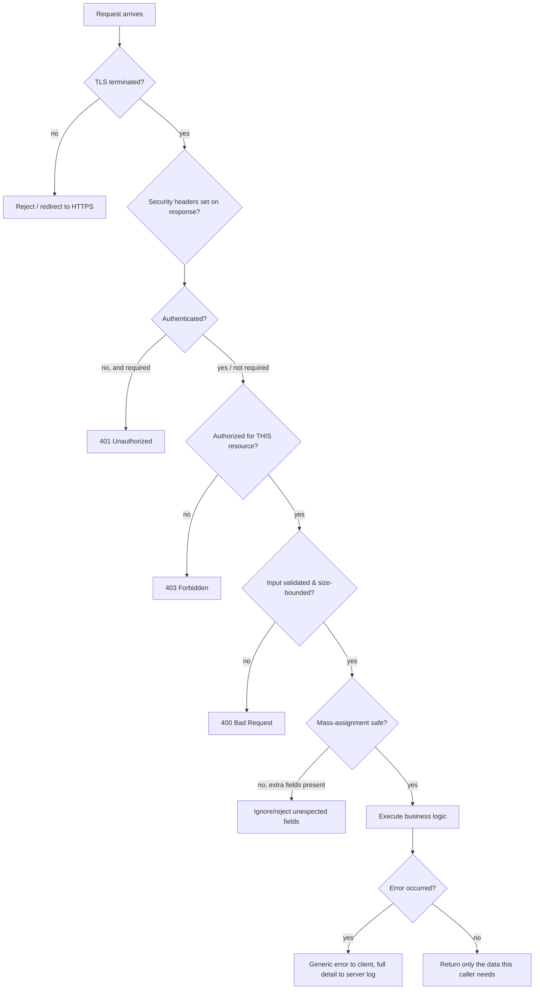

# 9. REST Endpoint Security

[08](08-api-and-service-security.md) covered API security at the *architecture* level
(service-to-service trust, rate limiting, identity). This file is one level down: the concrete,
per-endpoint things that get missed when a controller action is written, reviewed, and shipped in
isolation.



Every gate in this diagram is a place a real vulnerability from this file or [05](05-secure-coding-owasp.md)/[02](02-authorization.md) lives if it's skipped.

## 9.1 Security headers — cheap, and frequently just missing

A handful of response headers close off entire classes of browser-side attack for free, and the
only reason they're ever missing is nobody set them:

| Header | What it stops |
|---|---|
| `Content-Security-Policy` | XSS payload execution, even if injection succeeds (§ [05.2](05-secure-coding-owasp.md)) |
| `X-Content-Type-Options: nosniff` | Browser MIME-sniffing a response into an executable type it wasn't served as |
| `X-Frame-Options: DENY` (or CSP `frame-ancestors`) | Clickjacking — your page framed invisibly inside an attacker's page |
| `Strict-Transport-Security` | SSL-stripping (§ [03.6](03-transport-security-tls.md)) |
| `Referrer-Policy: strict-origin-when-cross-origin` | Leaking full URLs (which can contain tokens/IDs in the path) to third-party sites via the `Referer` header |
| `Cache-Control: no-store` | Sensitive API responses being cached by a shared proxy or browser disk cache |

**Recommended baseline:** apply these globally via middleware, not per-endpoint — a per-endpoint
opt-in means every new endpoint starts unprotected until someone remembers.

## 9.2 CORS — the header that's almost always misconfigured in one specific way

CORS exists to let a browser relax the same-origin policy for specific, server-approved
cross-origin callers. The single most common, most dangerous misconfiguration:

```
# NEVER combine these two:
Access-Control-Allow-Origin: *
Access-Control-Allow-Credentials: true
```

Browsers actually reject this exact combination outright — but the equivalent, browser-*accepted*
mistake is a server that **dynamically reflects whatever `Origin` header the request sent** back
as `Access-Control-Allow-Origin`, instead of checking it against an allowlist. That passes the
browser's rules (it's not literally `*`) while being functionally identical to `*` for credentialed
requests — any origin, including an attacker's, gets treated as approved.

**Recommended:** maintain an explicit allowlist of trusted origins; never reflect the request's
`Origin` header unchecked; only set `Access-Control-Allow-Credentials: true` for origins that
genuinely need cookie/credentialed cross-origin access.

## 9.3 Mass assignment

**Why it works:** an endpoint binds the incoming JSON body directly onto a domain/entity model
(`user.UpdateFrom(request.Body)`) without an explicit allowlist of bindable fields. If the entity
has a field like `isAdmin` or `accountBalance` that the client was never supposed to be able to
set, but the model binder doesn't know that, a client can simply include it in the request body
and have it silently accepted.

```
PATCH /api/users/me
{ "displayName": "Alice", "isAdmin": true }
```

**Fix:** bind to a dedicated request DTO that contains *only* the fields this endpoint is meant to
accept, then map explicitly from DTO to entity — never bind the wire payload directly onto the
full persistence model. This is one of the strongest arguments for the
Contracts/DTO-per-layer pattern that well-structured backends already use for other reasons
(keeping persistence details out of the API surface) — it happens to also close this exact
vulnerability class as a side effect.

## 9.4 HTTP verb semantics and idempotency

- `GET` must be **safe** (no side effects) and **idempotent** — a `GET` that deletes data or
  increments a counter breaks caching, breaks prefetching, and breaks any tooling that assumes GET
  is harmless (link scanners, browser prefetch, proxies retrying safely).
- `PUT` should be idempotent (calling it twice with the same body produces the same end state);
  `POST` is the correct verb for non-idempotent creation.
- **Idempotency keys** for `POST` operations with real-world side effects (payments, sending an
  email, creating a movement/reservation) — the client sends a unique key with the request; if the
  same key is retried (a network timeout causing a client-side retry, not malicious replay), the
  server recognizes it and returns the original result instead of performing the action twice.
  This is a reliability feature that also closes a duplicate-submission attack surface.
- **HTTP verb tampering** — some older or misconfigured frameworks apply different (sometimes
  weaker) authorization or validation logic depending on the verb, or accept `X-HTTP-Method-Override`
  headers uncritically. Verify authorization and validation logic is applied uniformly regardless
  of verb, and don't trust a method-override header for anything security-relevant.

## 9.5 Response size, pagination, and DoS via unbounded queries

An endpoint that returns "all records matching this filter" with no enforced page size limit is a
denial-of-service vector even with zero malicious intent behind the request — a filter that
happens to match a very large result set can exhaust server memory or the database connection pool
for one request, degrading service for everyone else. **Always enforce a maximum page size
server-side** (reject or clamp a client-requested page size above the limit — don't just document
a recommended limit and trust callers to respect it).

## 9.6 Error handling that doesn't leak

A stack trace, an ORM exception message, or a raw database error returned to the client is a
reconnaissance gift — it can reveal the framework/library versions in use (letting an attacker
target known CVEs precisely), internal file paths, table/column names, or even fragments of a SQL
query showing exactly how input was (or wasn't) parameterized. **Recommended pattern:** catch
exceptions at a single, centralized point (middleware/filter), log the full detail server-side with
a correlation ID, and return a generic message plus that correlation ID to the client — enough for
a support ticket, nothing an attacker can use.

## 9.7 API documentation exposure

Swagger/OpenAPI UI left publicly reachable in production (`/swagger`, `/api-docs`) hands an
attacker a complete, interactive map of every endpoint, parameter, and schema in your API — useful
for you in development, a reconnaissance shortcut for an attacker in production. **Recommended:**
gate interactive API documentation behind authentication, or disable it entirely, in any
environment reachable from the public internet.

## 9.8 Recommended baseline for any new REST endpoint

1. Explicit `[Authorize]`/equivalent — never rely on an inherited default (see
   [02 §2.6](02-authorization.md)).
2. A dedicated request DTO, not the persistence entity, bound from the wire payload.
3. Server-side validation of every field, including size/length bounds — never trust client-side
   validation as the only gate.
4. A resource-ownership/scope check for anything accepting an ID (§ IDOR,
   [05 §5.9](05-secure-coding-owasp.md)).
5. Pagination limits enforced, not just documented.
6. Errors caught centrally, generic message + correlation ID returned, full detail logged
   server-side only.
7. Global security headers applied via middleware, not per-endpoint opt-in.

## Further reading

- [OWASP REST Security Cheat Sheet](https://cheatsheetseries.owasp.org/cheatsheets/REST_Security_Cheat_Sheet.html)
- [PortSwigger — CORS misconfiguration, explained with real exploit examples](https://portswigger.net/web-security/cors)
- [OWASP Mass Assignment Cheat Sheet](https://cheatsheetseries.owasp.org/cheatsheets/Mass_Assignment_Cheat_Sheet.html)
- [MDN — HTTP security response headers reference](https://developer.mozilla.org/en-US/docs/Web/HTTP/Headers#security)
- [IETF — The Idempotency-Key HTTP Header Field (draft)](https://datatracker.ietf.org/doc/html/draft-ietf-httpapi-idempotency-key-header)
- [OWASP Error Handling Cheat Sheet](https://cheatsheetseries.owasp.org/cheatsheets/Error_Handling_Cheat_Sheet.html)

---
**Next:** [10. Infrastructure & Supply Chain →](10-infrastructure-and-supply-chain.md)
