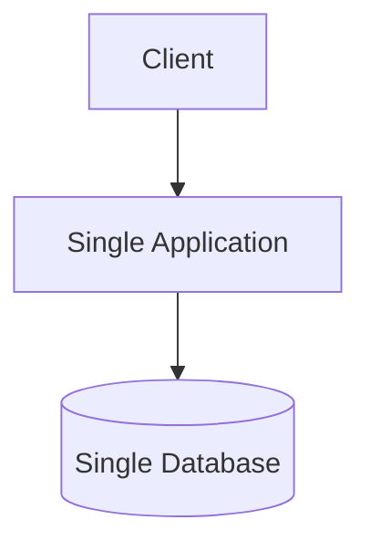
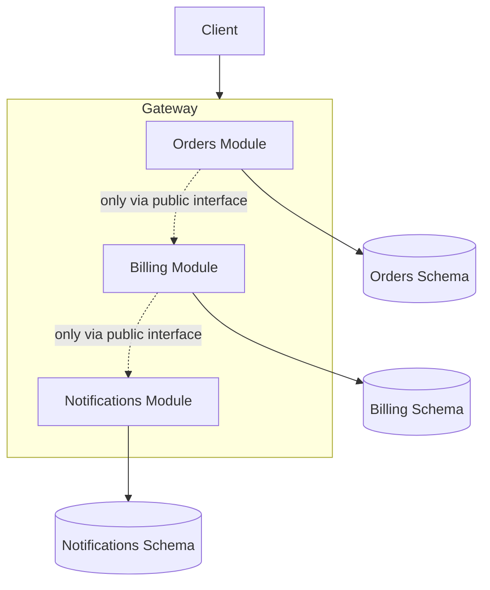
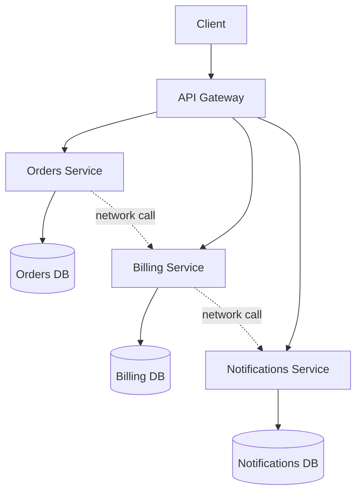

# 1. Monoliths, Modular Monoliths, Microservices

Every backend is one of three real shapes. Almost every architecture debate is actually a debate
about which of these three you're looking at, without saying so directly.

## 1.1 The monolith — one deployable, one codebase, no internal boundaries

Everything — user management, orders, billing, notifications — lives in one codebase, deploys as
one unit, and usually reads/writes one shared database with no enforced separation between
"modules." Any function can call any other function directly; any table can be joined against any
other table.

**Why it's the right default to start with:** one deployable means one thing to build, test, and
run locally. No network calls between "services" that are really just folders. Refactoring across
what would be a service boundary in a microservice architecture is a normal, safe, same-transaction
code change here. Most successful products started this way, including ones that later split into
microservices — the monolith wasn't a mistake, it was the fastest way to find out what the product
actually needed to be.

**Why it eventually hurts:** with no enforced boundaries, nothing stops the "orders" code from
directly querying the "billing" tables, and over time, everything ends up coupled to everything.
A single bug can take down the whole app. A single team's slow test suite blocks every other
team's deploy, because there's only one deploy.

## 1.2 The modular monolith — one deployable, enforced internal boundaries

Still one deployable, still one process — but the codebase is split into modules with **enforced**
boundaries: each module owns its own data (often its own database schema), exposes a narrow public
interface, and is forbidden — by code review, architecture tests, or build tooling — from reaching
into another module's internals. Cross-module calls go through that public interface only, same as
if it were a real network call, just without the network.

**This is the sweet spot for most real products**, and it's the shape you'll recognize once you've
worked in a modular monolith: it keeps the operational simplicity of one deployable (one thing to
build, test, deploy, monitor) while getting the main organizational benefit people reach for
microservices to get — teams can work on separate modules without constantly stepping on each
other's code, and a module's internals can be refactored freely as long as its public interface
doesn't change.

**The trap:** enforcing the boundary requires actual discipline — a linter rule, an architecture
test, or a code-review habit that actually blocks a "just this once" direct database query from one
module into another's schema. Without that enforcement, a modular monolith silently decays back
into a regular monolith with folder names that lie about the real dependency graph.

## 1.3 Microservices — many deployables, each with its own database

Each module from the modular monolith becomes its own independently deployable service, with its
own process, its own database, and a real network call (not just a function call) at every
boundary. Teams can now deploy independently, scale independently (more Orders instances during a
sale, without scaling Billing), and use different tech stacks per service if they genuinely need
to.

**What it actually costs, concretely — not vague "it's complex":**
- Every in-process function call at a module boundary becomes a **network call**, which can now
  time out, fail, or arrive out of order — see [03](03-synchronous-communication.md).
- A transaction that used to be one database commit across two tables is now a transaction that
  spans two separate databases, which plain ACID transactions can't do — see
  [07](07-data-consistency.md).
- You now need service discovery (how does Orders know Billing's current network address),
  distributed tracing (how do you follow one user request across five service logs), and often a
  message broker — real infrastructure, not just code.
- The "internal network is safe" assumption becomes actively dangerous here — every one of those
  network calls is a real trust boundary now, which is exactly the zero-trust argument the security
  curriculum makes in
  [08 — API & Service-to-Service Security](../08-api-and-service-security.md#81-its-on-the-internal-network-is-not-a-security-control).

## 1.4 Choosing — and why "just use microservices" is usually the wrong first answer

Microservices solve an **organizational** problem (many teams stepping on each other, needing
independent deploys) far more often than a **technical** one. Adopting them before you have that
organizational problem means paying the network-call, distributed-transaction, and operational
cost from day one, for a scaling problem you don't have yet. The realistic path most successful
systems actually take is monolith → modular monolith → microservices for the *specific* modules
that have earned the split (different scaling profile, different team, different release cadence)
— not a wholesale rewrite the moment the word "scale" comes up in a meeting.

## Why this matters once you get to security

Every architectural boundary above is also a **trust boundary question**: does the caller get
re-authenticated and re-authorized at this boundary, or does it inherit trust from wherever the
call came from? A modular monolith's "just a function call" module boundary and a microservice's
real network call boundary need *different* answers here — the security curriculum's cross-module
call patterns (in-process call vs. real HTTP call vs. event bus) map directly onto which of these
three shapes you're in.

---
**Next:** [2. Layered Architecture & Service Boundaries →](02-layered-architecture-and-boundaries.md)
