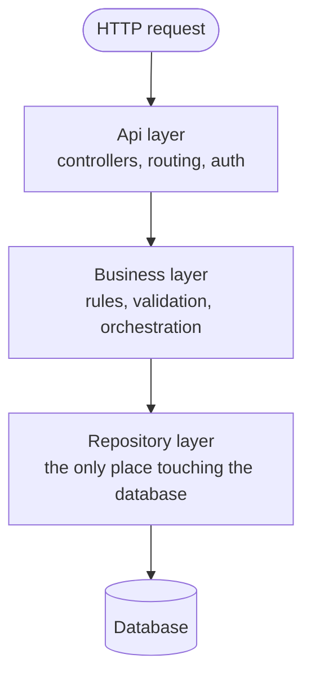
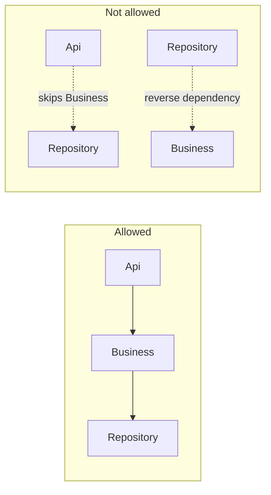

# 2. Layered Architecture & Service Boundaries

Whether you're inside a monolith, a modular monolith, or one microservice, the code itself is
almost always organized the same way internally: a stack of layers, each only allowed to talk to
the one directly below it.

## 2.1 The four layers

- **Api (Controllers)** — translates an HTTP request into a call to the Business layer, and the
  Business layer's result back into an HTTP response. No business logic lives here. This is where
  `[Authorize]` checks live — see
  [02 — Authorization](../02-authorization.md#21-the-core-rule-check-authorization-on-every-request-server-side)
  in the security curriculum.
- **Business (Services)** — the only layer allowed to have opinions: validation rules, what
  happens in what order, what counts as an error. Orchestrates one or more Repository calls into a
  single meaningful operation.
- **Repository** — the only layer allowed to touch the database directly (raw SQL, an ORM query).
  Everything above it works with plain data models, never a raw database row.
- **Database** — the actual storage.

## 2.2 Why the dependency only goes one direction

The rule isn't "organize your folders this way for tidiness" — it's "the Api layer may depend on
Business, Business may depend on Repository, and **never the other way around**, and never
skipping a layer." This one rule is what makes each layer independently testable and replaceable:

- Because Business only depends on an abstraction of Repository (an interface), you can test
  Business logic with a fake in-memory repository — no real database needed for most tests.
- Because Api only depends on an abstraction of Business, you can test that the right HTTP status
  gets returned for a given business result, without running real business logic.
- If Api could skip straight to Repository "just this once for a quick read," that read would
  bypass every validation and authorization rule the Business layer exists to enforce — this is
  precisely how an IDOR ([05 §5.9](../05-secure-coding-owasp.md#59-broken-access-control-idor) in
  the security curriculum) or a missing-permission-check bug gets introduced: someone found a
  shortcut around the layer that was supposed to be the only gate.

## 2.3 What crosses a layer boundary — contracts, not internal types

The Business layer should never receive or return the Repository's raw database entity — it should
receive/return a plain data-transfer object (a "contract" or "model") that has no persistence-only
fields (internal row versioning columns, soft-delete flags) and no framework dependency. This
matters for two reasons:

- **Api never has to expose a database column** it has no business exposing — see the mass
  assignment discussion in
  [09 — REST Endpoint Security](../09-rest-endpoint-security.md#93-mass-assignment): binding the
  wire payload straight onto a persistence entity is exactly how a client ends up able to set a
  field like `isAdmin` that was never meant to be user-settable.
- **The Business layer's logic doesn't depend on what database or ORM is behind it.** Swapping SQL
  Server for Postgres, or an ORM for hand-written queries, should only ever touch the Repository
  layer — if it forces changes in Business or Api, the boundary wasn't real, it was just a folder
  name.

## 2.4 Module boundaries are the same rule, one level up

In a modular monolith ([01 §1.2](01-monoliths-and-microservices.md#12-the-modular-monolith--one-deployable-enforced-internal-boundaries)),
the same one-direction-only rule applies **between modules**, not just between layers inside one
module: Module A's Business layer may depend on Module B's public interface, but never on Module
B's Repository or Database directly. This is exactly the rule a dedicated architecture test exists
to enforce — and exactly the rule that gets violated under deadline pressure, one "just this once"
direct reference at a time, until the module boundary is real in the folder structure but fictional
in the actual dependency graph.

## Why this matters once you get to security

Every finding in the security curriculum that says "X reached into Y's internals directly" (a
missing authorization check because Api skipped Business, a module boundary violation, a
cross-module database reference) is a violation of exactly this one-direction-dependency rule.
Learning to spot "wait, why does this layer/module depend on that one" in a dependency graph is
the single most transferable skill from this file into actual security code review.

---
**Next:** [3. Synchronous Communication: REST & RPC →](03-synchronous-communication.md)
