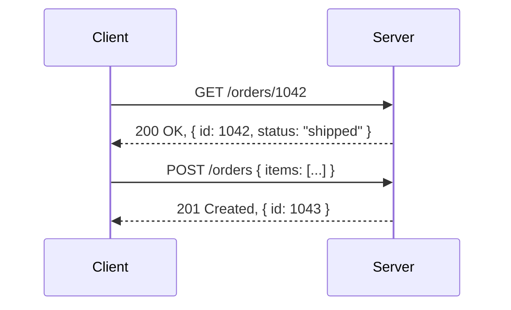
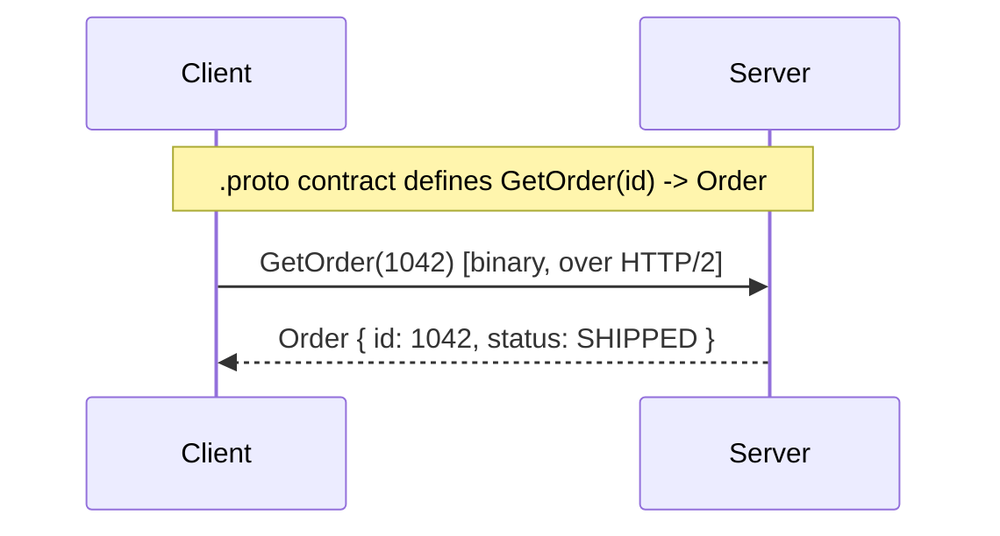
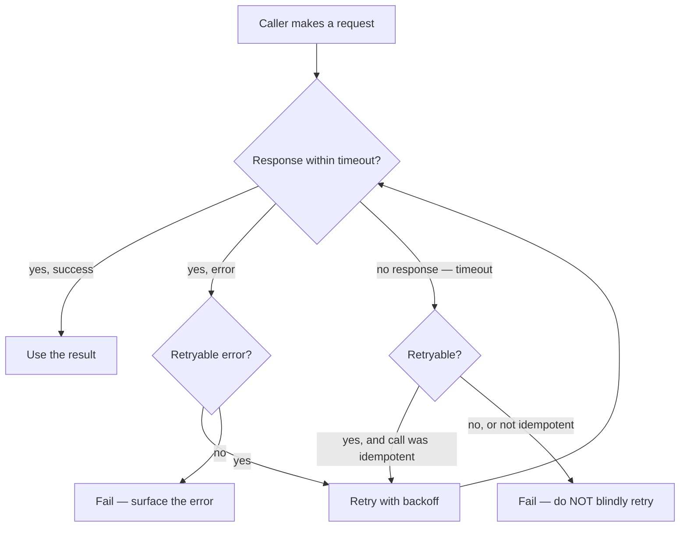
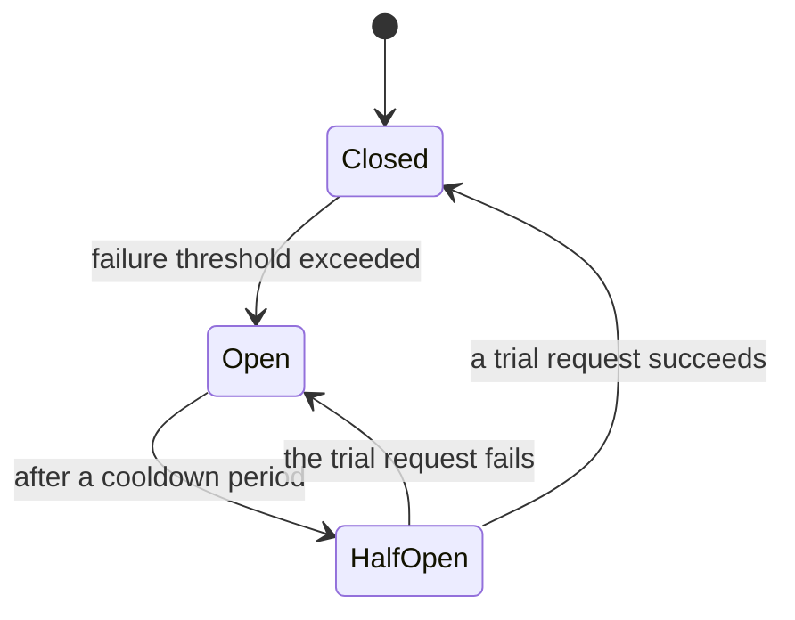

# 3. Synchronous Communication: REST & RPC

Once a call between two services is a real network call (§1.3), it can fail in ways an in-process
function call never could — and most of this file is about what has to change in your code once
that becomes true.

## 3.1 REST — resources, over HTTP, stateless

REST models the system as **resources** (`/orders`, `/orders/1042`) manipulated with standard HTTP
verbs (`GET` read, `POST` create, `PUT`/`PATCH` update, `DELETE` remove), and each request is
**stateless** — the server doesn't remember anything about the previous request; every request
carries everything needed to handle it (including, per
[01](../01-authentication.md), the auth token). This statelessness is *why* REST APIs scale
horizontally so easily: any server instance can handle any request, since none of them are holding
onto per-client state in memory.

## 3.2 RPC / gRPC — calling a function, not a resource

RPC (Remote Procedure Call) frames the same idea differently: instead of "resources and verbs,"
it's "call this specific function on that other service, with these typed arguments, get back a
typed result" — much closer to how the code actually reads. **gRPC** is the dominant modern
implementation: a strict schema (a `.proto` file) generates strongly-typed client/server code in
whatever language each side uses, over HTTP/2 with binary (Protobuf) payloads instead of JSON text.

**When each tends to win:** REST's human-readable JSON and universal HTTP tooling make it the
default for public APIs and anything a browser calls directly. gRPC's strict typed contract and
binary efficiency make it common for internal service-to-service calls in a microservice
architecture, where every service is code you control and raw throughput/latency matters more than
human-readability in a browser's network tab.

## 3.3 What a network call adds that a function call never had

A function call either returns or throws, essentially instantly. A network call adds a whole new
failure mode that doesn't exist in-process: **you genuinely don't know if it worked.** The request
might never have reached the server, or it might have been processed successfully and only the
*response* got lost on the way back — from the caller's side, both look identical: a timeout.

This is exactly why **idempotency** matters (also covered from the security angle in
[09 §9.4](../09-rest-endpoint-security.md#94-http-verb-semantics-and-idempotency)): if an operation
is safe to perform twice with the same result (a `GET`, or a `POST` carrying an idempotency key),
retrying after a timeout is safe. If it isn't (a plain `POST /charge-card` with no idempotency key),
blindly retrying a timed-out request can charge the customer twice — the first request may well have
already succeeded.

## 3.4 Timeouts, retries, and circuit breakers

- **Timeouts** — every network call needs one. Without a timeout, a slow downstream service can
  hold your service's threads/connections open indefinitely, until *your* service also runs out of
  capacity — a slowdown in one service silently becomes an outage in another.
- **Retries with backoff** — retrying immediately after a failure just hits an already-struggling
  service again, harder. Exponential backoff (wait longer between each retry) gives the downstream
  service room to recover.
- **Circuit breakers** — after enough consecutive failures calling a specific service, stop calling
  it for a while and fail fast instead, instead of piling up more slow, doomed requests against it.
  This is the same instinct as a household circuit breaker: better to cut power to a faulty circuit
  than let it burn down the house it's attached to.

## Why this matters once you get to security

Timeouts and retries aren't just reliability concerns — they're the exact mechanism behind
denial-of-service resilience (a downstream slowdown that isn't contained by a timeout/circuit
breaker can cascade into a full outage, which is itself a security incident) and behind the
"idempotency keys close a duplicate-submission attack surface" point made in
[09 §9.4](../09-rest-endpoint-security.md#94-http-verb-semantics-and-idempotency). And every
cross-service REST/gRPC call is precisely the kind of trust boundary the zero-trust argument in
[08](../08-api-and-service-security.md) is about — "it's just an internal service call" is a
reliability statement, never a security one.

---
**Next:** [4. Asynchronous Communication: Queues & Events →](04-asynchronous-communication.md)
