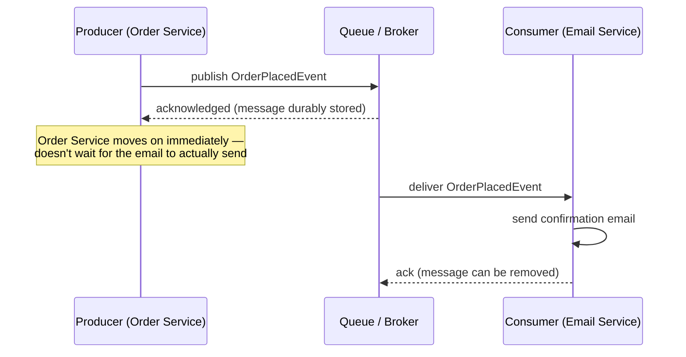

# 4. Asynchronous Communication: Queues & Events

Synchronous calls ([03](03-synchronous-communication.md)) require both sides to be up, reachable,
and fast enough *right now*. Asynchronous communication exists for everything that shouldn't have
to wait on that.

## 4.1 The core idea: decouple "send" from "handle"



The producer publishes a message and moves on immediately — it doesn't wait for, or even know
about, whoever eventually handles it. The broker (a message queue like RabbitMQ/SQS, or an
event-streaming platform like Kafka/Azure Service Bus) durably stores the message until a consumer
successfully processes it. If the Email Service is down for ten minutes, the message just waits —
the Order Service was never blocked on it, and no order gets lost.

## 4.2 Point-to-point queues vs. publish/subscribe

```mermaid
flowchart LR
    subgraph Queue -- one consumer group
    P1[Producer] --> Q1[Queue] --> C1[Consumer]
    end
    subgraph Pub/Sub -- many independent subscribers
    P2[Producer] --> T[Topic]
    T --> S1[Subscriber: Email]
    T --> S2[Subscriber: Analytics]
    T --> S3[Subscriber: Inventory]
    end
```

- **Queue (point-to-point):** one message, consumed by exactly one worker among a pool — used to
  distribute work (process these 10,000 image uploads across 5 worker instances).
- **Topic (publish/subscribe):** one message, delivered to *every* independent subscriber —
  used to broadcast a fact ("an order was placed") to every part of the system that cares, without
  the publisher needing to know who's listening today or who might start listening tomorrow.

## 4.3 At-least-once delivery, and why your consumer must be idempotent

Almost every real message broker guarantees **at-least-once** delivery, not exactly-once — a
message might be delivered twice (a consumer crashes after processing but before acknowledging,
so the broker redelivers it, having no way to know the work already happened). This isn't a defect
to route around; it's a deliberate tradeoff, because guaranteeing *exactly*-once delivery across a
real, unreliable network is far more expensive and complex than most systems need.

**The consequence for your code:** a message consumer must be **idempotent** — processing the same
message twice must produce the same end state as processing it once (e.g. "mark order 1042 as
paid," which is safe to run twice, rather than "increment paid-orders count by 1," which isn't).
This is the exact same idempotency principle as
[03 §3.3](03-synchronous-communication.md#33-what-a-network-call-adds-that-a-function-call-never-had),
showing up again on the consuming side instead of the calling side.

## 4.4 Event-driven architecture — reacting to facts, not commands

A **command** ("ChargeCard") tells a specific service what to do and expects a direct response. An
**event** ("OrderPlaced", "PaymentFailed") states a fact that already happened, broadcast to
whoever's interested, with no expectation of a direct reply. Building a system around events —
services reacting to facts published by other services, rather than directly calling each other —
is what lets you add a brand-new consumer (say, a fraud-detection service that reacts to every
`OrderPlaced` event) without changing a single line in the Order Service that publishes it. That
decoupling is the main architectural payoff of going event-driven, and it's also exactly why event
schemas need real discipline — every consumer, present and future, depends on a contract the
publisher can't see all of.

## Why this matters once you get to security

An event bus is a real trust and data-flow boundary, same as any network call — a message
containing more data than a given consumer actually needs is the async equivalent of the
"don't return more data than the caller needs" over-exposure risk in
[08 §8.6](../08-api-and-service-security.md#86-least-exposure-api-design). And because a message
often outlives the request that created it (sitting in a queue, replayed on failure, stored in a
dead-letter queue for later inspection), anything sensitive inside it is now data-at-rest somewhere
you may not have accounted for — the same "don't put a secret in a JWT payload" instinct from
[01 §1.3](../01-authentication.md#13-token-based-authentication-bearer-tokens-jwt) applies here too.

---
**Next:** [5. WebSockets & Real-Time Communication →](05-websockets-and-realtime.md)
