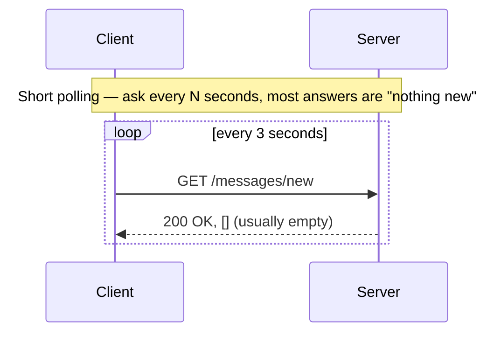
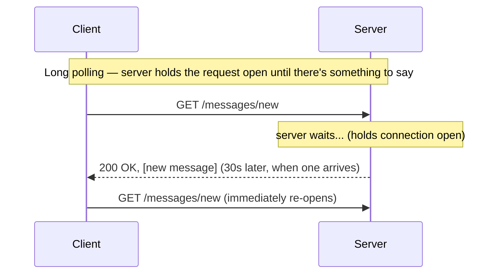
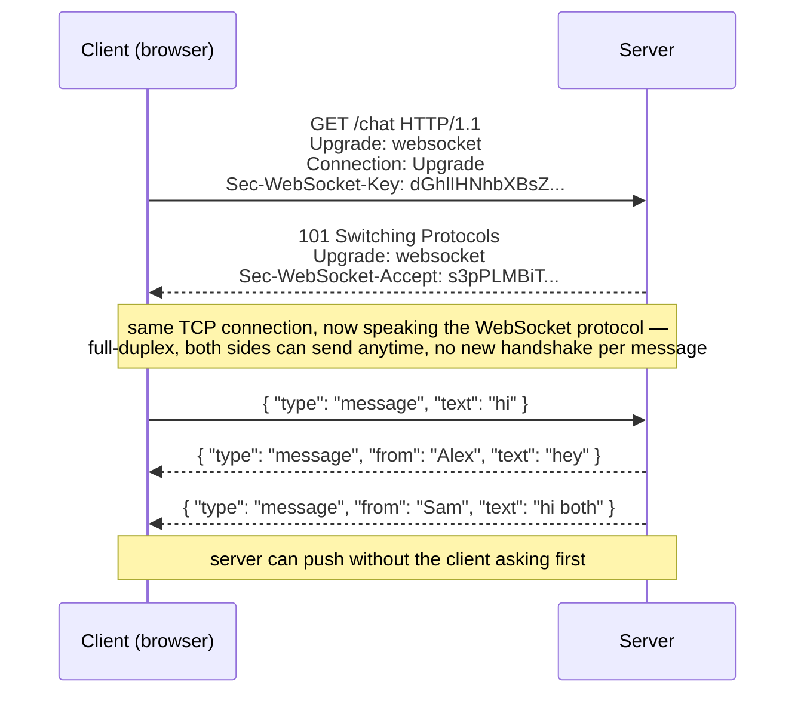
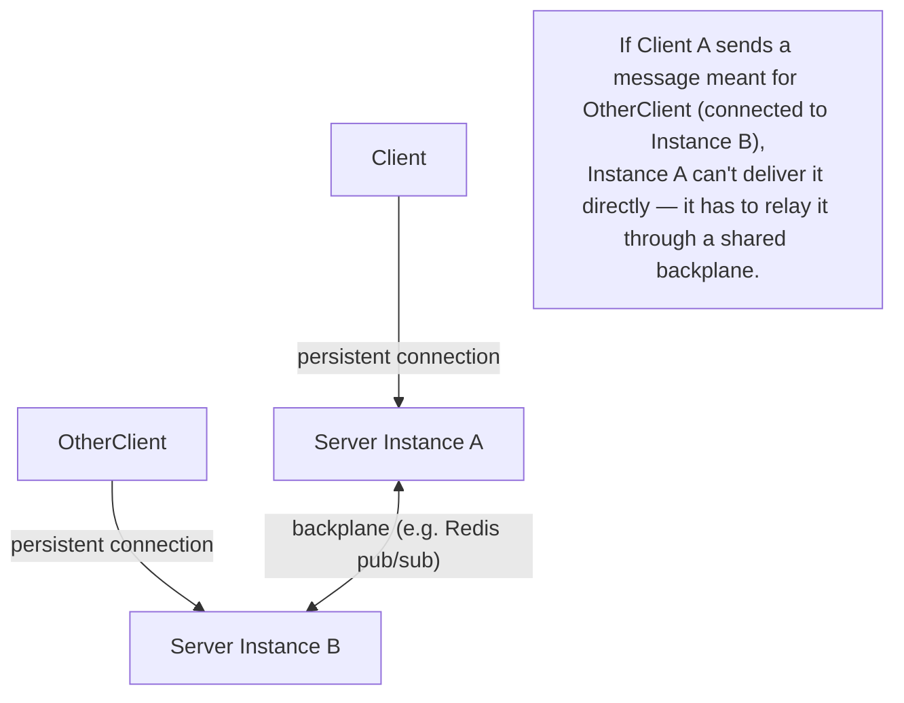

# 5. WebSockets & Real-Time Communication

Everything in [03](03-synchronous-communication.md) and [04](04-asynchronous-communication.md)
assumes the client asks and the server answers, once, per request. WebSockets exist for the case
where the server needs to push new data to the client **without being asked first** — a chat
message arriving, a live price ticking, another user's cursor moving on a shared document.

## 5.1 The problem: HTTP is request-response, real-time isn't

Before WebSockets were standardized, people simulated "the server is telling me something new"
using plain HTTP in increasingly wasteful ways:

Short polling wastes requests on "nothing happened." Long polling is better (the server only
replies once there's actually something to say) but still re-opens a brand-new HTTP request/response
cycle, with all its overhead, every single time.

## 5.2 The WebSocket handshake — upgrading one connection, then keeping it open

A WebSocket connection starts as a normal HTTP request carrying an `Upgrade: websocket` header. If
the server agrees, it responds `101 Switching Protocols`, and from that point on the **same
underlying TCP connection** is reused for a persistent, **full-duplex** channel — either side can
send a message at any time, with none of the per-message overhead of opening a new HTTP
request/response cycle (no headers, no new TCP handshake, no new TLS handshake). This is why
WebSockets are the right tool specifically when messages are frequent and low-latency matters (a
chat app, a multiplayer game, live collaborative editing) — not for "check for an update once a
minute," where a normal periodic request is simpler and cheaper to reason about.

**Server-Sent Events (SSE)** are worth knowing as the middle ground: a single long-lived HTTP
response the server keeps streaming events down over `text/event-stream`, one-directional
(server → client only, over plain HTTP, reconnects automatically). Simpler than a WebSocket when
the client never needs to send anything back over the same channel — a live news ticker or a
progress bar, not a chat.

## 5.3 What changes operationally once a connection stays open

A REST server handling stateless requests can be scaled by just adding more identical instances
behind a load balancer — any instance can handle any request, per
[3.1](03-synchronous-communication.md#31-rest--resources-over-http-stateless). A WebSocket server
breaks that assumption: **the client is connected to one specific server instance**, for as long
as that connection lives, and that instance is now holding real state in memory (who's connected,
what room they're in).

This is why real-time systems at scale need a **backplane** — a shared pub/sub layer (Redis is the
common choice) that every server instance subscribes to, so a message arriving on Instance A meant
for a client connected to Instance B can be relayed across instances instead of only reaching
whoever happens to be on the same box. Without this, "broadcast this chat message to everyone in
the room" quietly only reaches whichever fraction of the room is connected to the same instance as
the sender.

## 5.4 The security shape of a WebSocket is genuinely different from REST

- **No per-message headers.** A REST call re-sends its `Authorization` header on every request;
  a WebSocket authenticates **once, at connection time** (a token in the initial handshake URL or
  first message) and then trusts that connection for its entire lifetime. If that connection is
  later supposed to lose access (a permission revoked, a session ended), the server has to actively
  track and close the socket — there's no next request to reject.
- **The browser's same-origin protections work differently here.** A WebSocket handshake doesn't
  enforce CORS the way a `fetch()` does — a malicious page can open a WebSocket connection to your
  server just as easily as your own frontend can. The server **must** check the `Origin` header
  itself during the handshake and reject connections from origins it doesn't recognize — skipping
  this is the WebSocket-shaped equivalent of the CSRF risk covered in
  [05 §5.3](../05-secure-coding-owasp.md#53-cross-site-request-forgery-csrf) of the security
  curriculum, since the browser will happily attach cookies to a WebSocket handshake too.
- **Every message needs its own authorization check**, same as every REST request would — a
  connection being authenticated once at connect-time doesn't mean every subsequent message on it
  is automatically authorized to do whatever it asks.

## Why this matters once you get to security

WebSockets are exactly the kind of feature where "we did the auth check at login" quietly becomes
the *only* check that ever runs, because there's no natural per-request moment left to remind
anyone to re-check. Real WebSocket vulnerabilities in practice are almost always one of: missing
`Origin` validation (cross-site WebSocket hijacking), a connection whose authorization never gets
re-checked after a permission change, or a message handler that trusts the payload's claimed
identity instead of the identity established at connect-time.

---
**Next:** [6. API Gateways & the BFF Pattern →](06-api-gateways-and-bff.md)
