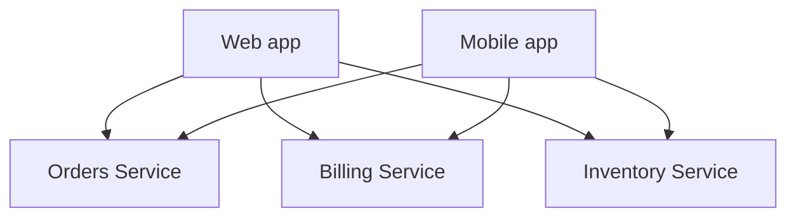
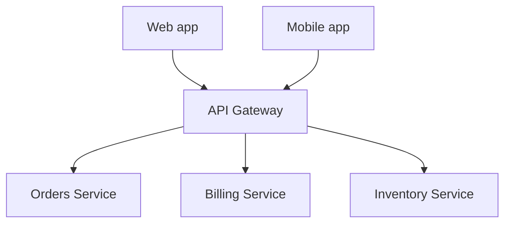
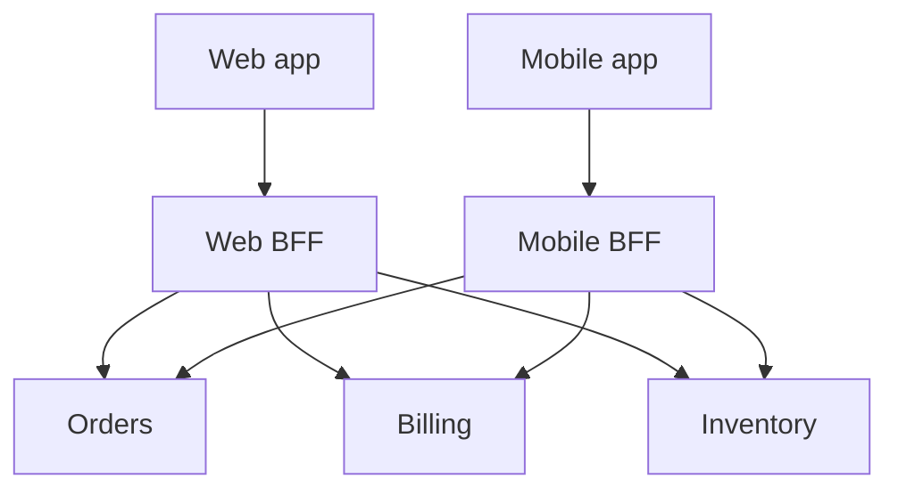

# 6. API Gateways & the BFF Pattern

Once a system is more than one service ([01](01-monoliths-and-microservices.md)), something has to
decide which requests go where, and it's usually not "let every client talk to every service
directly."

## 6.1 The problem without a gateway

Every client needs to know every service's address, handle auth against each one separately, and
absorb every internal reshuffling (a service splitting into two, a URL changing) directly. Nothing
stands between the outside world and the internal service topology.

## 6.2 An API Gateway — one front door

A single entry point every external request goes through first. The gateway commonly handles, in
one place instead of duplicated across every service:
- **Routing** — `/orders/*` goes to the Orders service, `/billing/*` to Billing.
- **Authentication** — verify the token once at the door, so internal services can trust it's
  already been checked (still re-validated per-service in a real zero-trust setup, per
  [08](../08-api-and-service-security.md), but the gateway is the natural place for the first
  check).
- **Rate limiting** — the natural enforcement point for the per-IP/per-key limits described in
  [08 §8.2](../08-api-and-service-security.md#82-rate-limiting-and-abuse-prevention), since it's
  the one place that sees every request regardless of which service it's headed to.
- **TLS termination, request logging, response caching** — cross-cutting concerns that would
  otherwise be duplicated in every service.

This also directly closes the "internal implementation detail exposed to the world" problem — a
service can be split into two, renamed, or re-hosted entirely, and as long as the gateway's public
routes stay the same, no client ever needs to know.

## 6.3 The BFF (Backend-for-Frontend) pattern

A single generic gateway works well until different clients genuinely need different shapes of
data from the same underlying services — a mobile app wants a small, aggregated payload to save
battery and data; a web dashboard wants a richer, more detailed one; a partner's server-to-server
integration wants something narrower and more stable than either. The **BFF pattern** gives each
client type its *own* thin backend, owned by the team that owns that client, whose only job is to
call the real services and reshape/aggregate their responses into exactly what that specific
client needs — instead of one generic API straining to be everything to everyone, accumulating
optional fields and query parameters for every client's slightly different need.

**The tradeoff:** more services to run and deploy, and some logic (e.g. "how do we present an
order's status") can drift slightly between BFFs if it's not centralized carefully. Worth it
specifically when different clients' needs have genuinely diverged, not by default for every
project on day one.

## Why this matters once you get to security

The gateway is where several of the [09 — REST Endpoint Security](../09-rest-endpoint-security.md)
recommendations naturally live in one place instead of being duplicated (and inevitably
forgotten in one service) across every service individually: global security headers
([09 §9.1](../09-rest-endpoint-security.md#91-security-headers--cheap-and-frequently-just-missing)),
CORS policy ([09 §9.2](../09-rest-endpoint-security.md#92-cors--the-header-thats-almost-always-misconfigured-in-one-specific-way)),
and the first authentication check. But it also means the gateway is a single, high-value target —
a bug or misconfiguration there potentially exposes every service behind it at once, which is
exactly why "authenticated at the gateway" should never be the *only* check a service behind it
relies on.

---
**Next:** [7. Data Consistency Across Services →](07-data-consistency.md)
