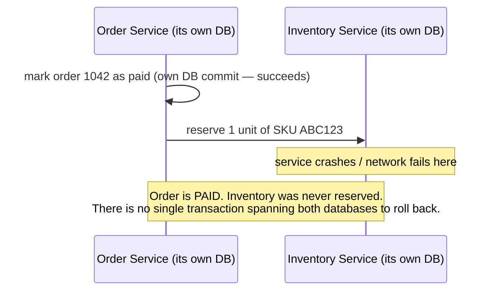
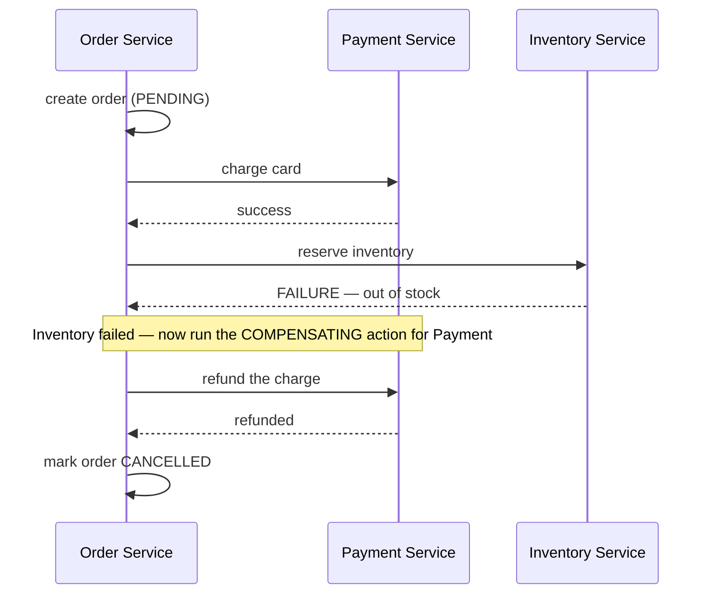

# 7. Data Consistency Across Services

This is the file that explains why splitting a database in two (§1.3) is a much bigger deal than
it sounds — a single database transaction guarantees things that simply don't exist once two
databases are involved.

## 7.1 What a single database gave you for free

```sql
BEGIN TRANSACTION;
  UPDATE orders SET status = 'paid' WHERE id = 1042;
  UPDATE inventory SET reserved = reserved - 1 WHERE sku = 'ABC123';
COMMIT;
```

One database, one transaction: either both updates happen, or neither does — a crash between the
two lines leaves the database exactly as if nothing had run at all. This is the "A" (Atomicity) in
ACID, and it's easy to take for granted until it's gone.

## 7.2 Why you can't just do the same thing across two services



There is no built-in mechanism for a transaction to span two independent databases the way it
spans two tables in one database. If the second step fails after the first has already committed,
you're left in a genuinely inconsistent state, and something has to notice and fix it — nothing
does that automatically the way a single-database rollback would.

## 7.3 The CAP theorem, in the version that actually matters day to day

Formally: a distributed system can't simultaneously guarantee Consistency (every read sees the
latest write), Availability (every request gets a response), and Partition tolerance (it keeps
working when the network between nodes drops) — you can only fully have two of the three, and
since real networks *do* drop packets, partition tolerance isn't really optional, which means the
practical choice is between consistency and availability when a partition happens.

**What this means in practice, not in theory:** most real systems choose **eventual consistency**
— a write to Service A doesn't have to be instantly visible everywhere else in the system, only
*eventually*, once whatever asynchronous mechanism propagates it (an event, per
[04](04-asynchronous-communication.md)) has had a chance to run. A customer's shipping address
update might take a few seconds to show up in the Shipping service's own copy of it — that's a
deliberate, accepted tradeoff, not a bug, in exchange for each service staying available and fast
even if another service is temporarily down or slow.

## 7.4 The Saga pattern — a "transaction" made of compensating steps

Since you can't roll back a real cross-database transaction, the Saga pattern handles a multi-step
operation as a sequence of local transactions, each with a defined **compensating action** to
manually undo it if a later step fails:



Each step's compensating action ("refund the charge") is real business logic someone has to write
deliberately — it's not automatic the way a database rollback is. This is the actual cost of
splitting a transaction across services: what used to be "the database handles consistency for
free" becomes "someone has to design and implement what happens when step 3 of 4 fails," for every
multi-step operation that spans a service boundary.

## Why this matters once you get to security

Eventual consistency creates a genuine **time-of-check-to-time-of-use** window: a permission
revoked in one service might not have propagated to another service's cached copy yet, meaning a
request could be authorized against stale data for a real, non-zero window. This is a legitimate
design tradeoff, not automatically a bug — but it means "when does this security-relevant fact
actually become true everywhere" is a question worth asking explicitly for anything permission- or
identity-related that crosses a service boundary, rather than assuming a change is instantaneous
everywhere the moment it's saved in one place.

---
**Next:** you've finished the architecture primer — head to
[The Practitioner Track](../PRACTITIONER-TRACK.md), or back to
[the architecture index](README.md).
